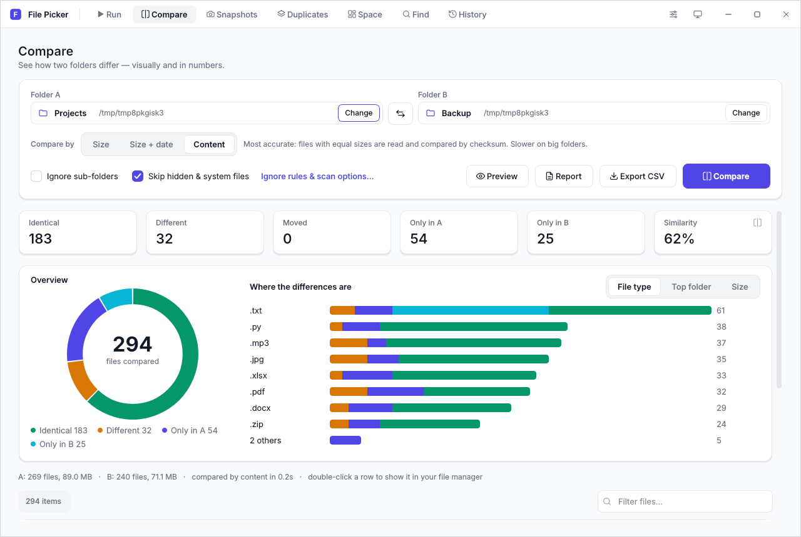
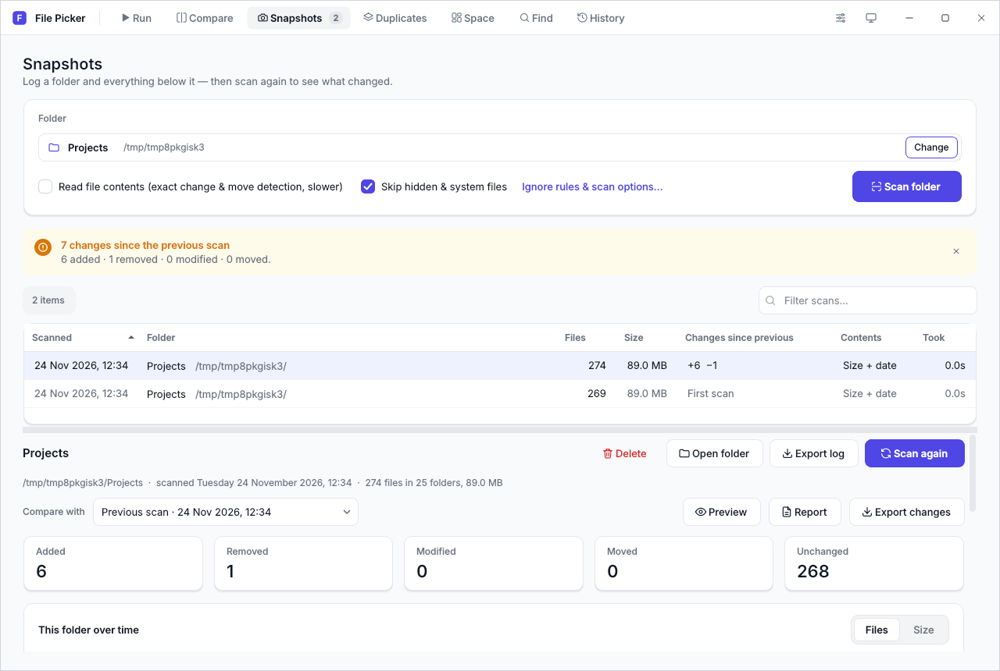
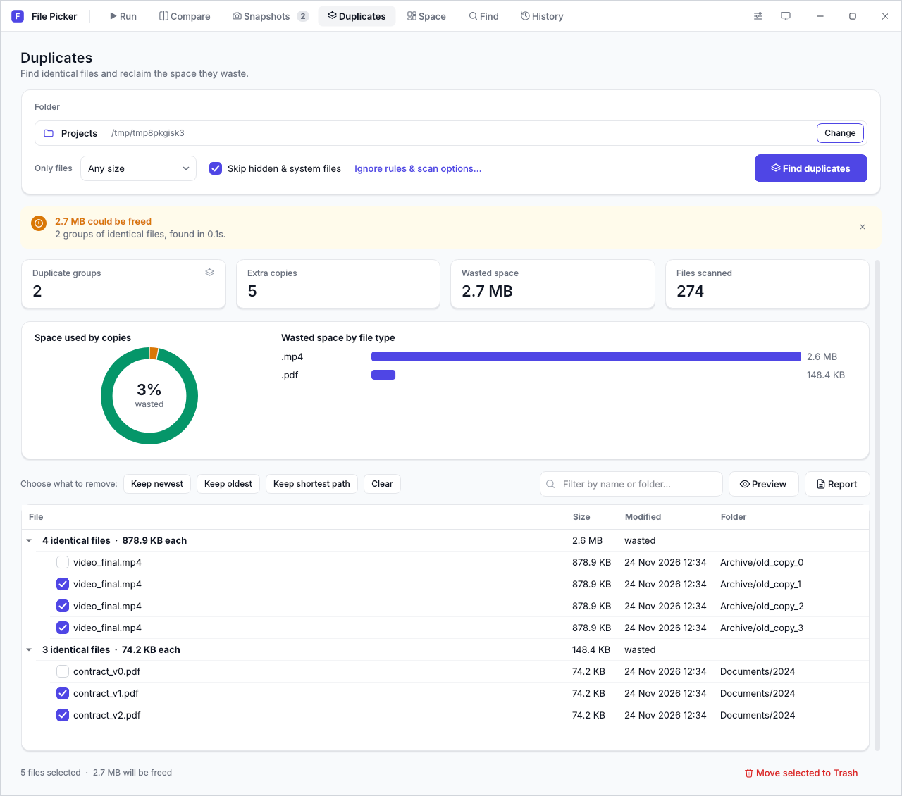
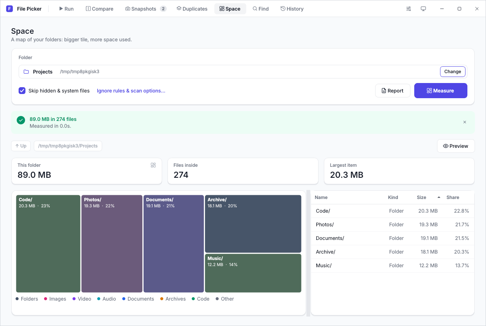
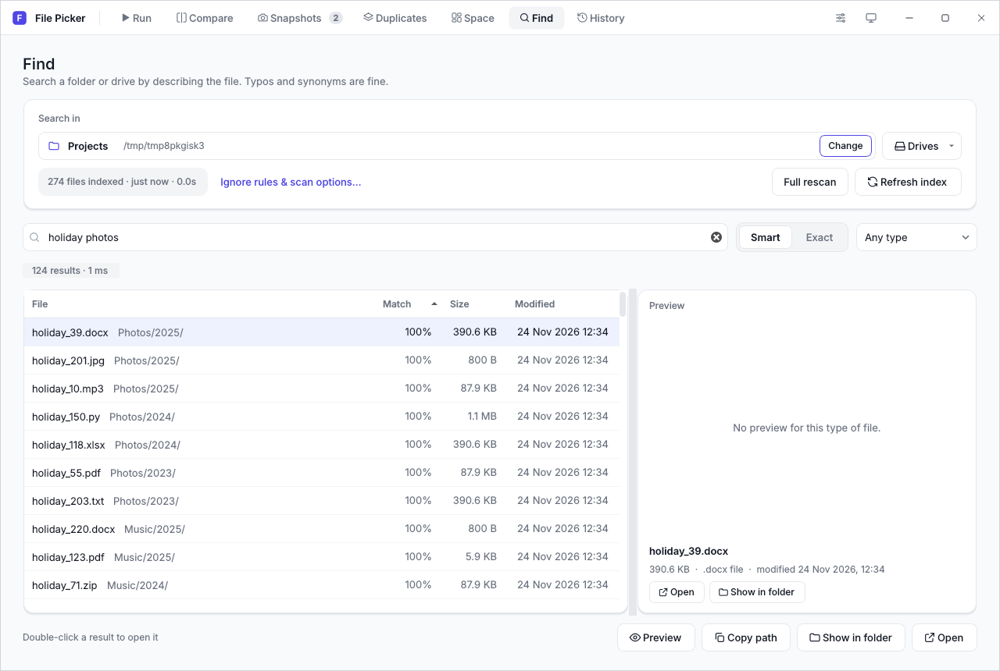
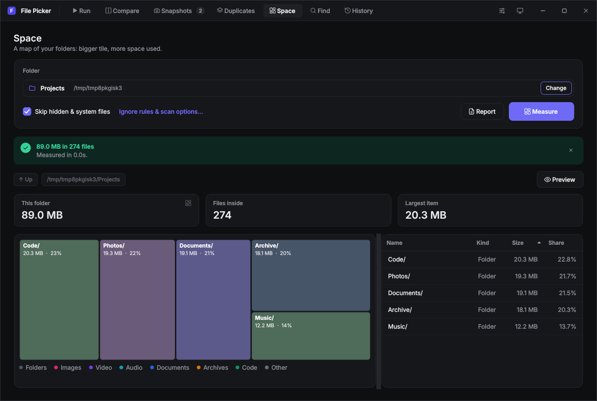
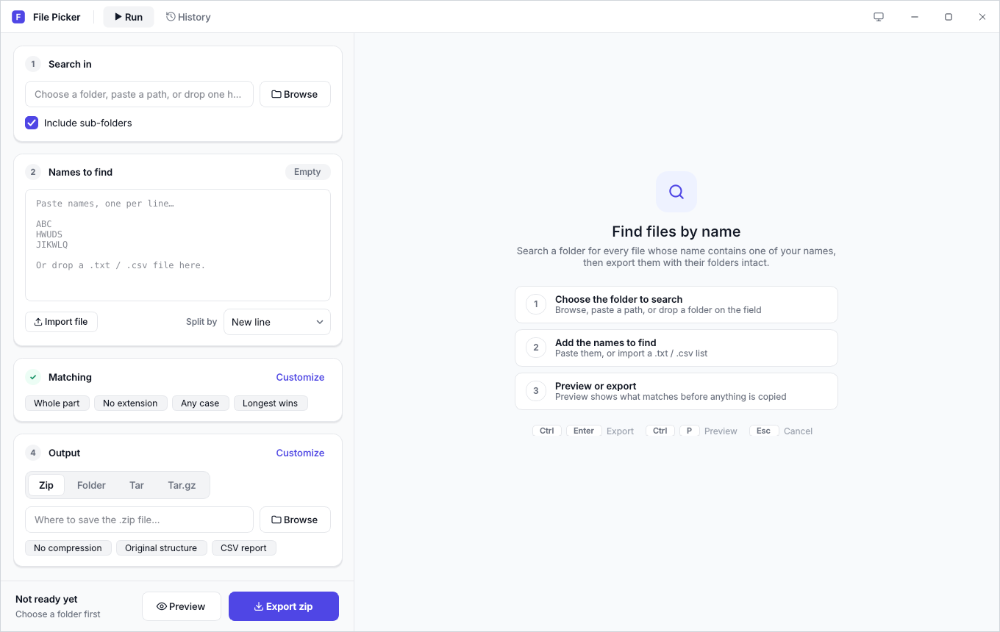
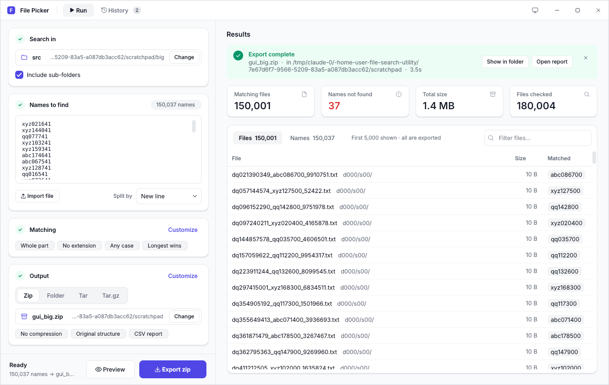

# File Picker

[](https://github.com/Sepiolina/Files-Picker/actions/workflows/build.yml)

**File Picker** is a desktop application for finding and exporting files from large directory structures.

Provide a list of filenames by pasting them directly or importing a `.txt` or `.csv` file. File Picker searches the selected directory and its subfolders, identifies matching files, and exports them while preserving their original folder structure.

Supported output formats include **ZIP, TAR, TAR.GZ, and regular folders**.

## Features

- **Fast file searching:** Search large directory structures without reading file contents.
- **Flexible matching:** Choose between exact, partial, prefix, suffix, and whole-part matching.
- **Multiple input methods:** Paste filenames or import lists from TXT and CSV files.
- **Organized exports:** Preserve the original directory structure or group results by search name.
- **Multiple export formats:** Export to ZIP, TAR, TAR.GZ, or a regular folder.
- **Preview before exporting:** Review matches and identify missing filenames without copying files.
- **Progress tracking:** Monitor operations and cancel them when needed.
- **Export history:** Review previous exports, restore settings, and rerun operations.
- **Compare folders:** Compare any two folders (same or different drives) with charts and a filterable table of identical, different, moved and one-sided files.
- **Snapshots:** Log a folder and everything below it, then scan again to see what was added, removed, modified or moved.
- **Duplicates:** Find files with identical content, see the space they waste, and move the extra copies to the Trash.
- **Space:** A clickable treemap showing which folders and files use your disk.
- **Find:** Search a folder or whole drive with a typo-tolerant "smart" search backed by a persistent cache.
- **Previews, ignore rules and reports:** Preview pictures and text, skip folders with `.gitignore`-style rules, skip online-only cloud files, and save HTML or PDF reports.
- **Cross-platform support:** Available for Windows, macOS, and Linux.
- **Command-line support:** Run searches and exports without opening the graphical interface.

## Screenshots

<table>
  <tr>
    <td width="50%">
      <a href="docs/screenshots/7-compare.png"></a><br>
      <sub><b>Compare</b> — two folders side by side: what is identical, different, moved or missing.</sub>
    </td>
    <td width="50%">
      <a href="docs/screenshots/8-snapshots.png"></a><br>
      <sub><b>Snapshots</b> — log a folder, scan again later, see exactly what changed.</sub>
    </td>
  </tr>
  <tr>
    <td width="50%">
      <a href="docs/screenshots/9-duplicates.png"></a><br>
      <sub><b>Duplicates</b> — identical files grouped, wasted space shown, extras moved to the Trash.</sub>
    </td>
    <td width="50%">
      <a href="docs/screenshots/10-space.png"></a><br>
      <sub><b>Space</b> — a treemap of what uses your disk; click a folder to look inside.</sub>
    </td>
  </tr>
  <tr>
    <td width="50%">
      <a href="docs/screenshots/11-find.png"></a><br>
      <sub><b>Find</b> — describe the file; typos and synonyms are fine. Results come from a cached index, with a preview.</sub>
    </td>
    <td width="50%">
      <a href="docs/screenshots/12-dark-space.png"></a><br>
      <sub><b>Dark theme</b> — every tab follows the light or dark appearance.</sub>
    </td>
  </tr>
</table>

The original **Run** workflow (find files by a list of names and export them) is shown under [Getting Started](#getting-started) and [Using File Picker](#using-file-picker).

## Download

Prebuilt programs are attached to each release on this repository's **Releases** page, and every push to `main` produces the same files as downloadable _artifacts_ of the **Build** workflow run.

| Platform                 | File                          | How to start it                                                                                                                                          |
| ------------------------ | ----------------------------- | -------------------------------------------------------------------------------------------------------------------------------------------------------- |
| Windows 10 / 11 (x64)    | `FilePicker-windows-x64.exe`  | Double-click. See [Windows security warnings](#windows-security-warnings) if SmartScreen appears.                                                        |
| macOS (Apple silicon)    | `FilePicker-macos-arm64.zip`  | Unzip, then right-click `FilePicker.app` → **Open** the first time (the app is not code-signed). Or run `xattr -dr com.apple.quarantine FilePicker.app`. |
| Linux (x64)              | `FilePicker-linux-x64.tar.gz` | `tar -xzf FilePicker-linux-x64.tar.gz && ./FilePicker`. On a minimal install you may need `sudo apt install libxcb-cursor0`.                             |
| Command-line engine only | `picker-engine-<os>-<arch>`   | The Go engine without the interface (see [Command-Line Interface](#command-line-interface)).                                                             |

Each release also includes `SHA256SUMS.txt` so downloads can be verified. Intel Macs can run from source (below) or get a build by adding an Intel macOS runner to the matrix in `.github/workflows/build.yml`.

## Project Structure

File Picker separates the search engine from the graphical interface. This allows the core functionality to operate independently while keeping the desktop application responsive.

```text
file_picker/
├── engine/       Go engine: search, export, and the fast tree / hash scanners
├── gui/          Python and Qt desktop interface (and its tests in gui/tests)
├── docs/         Protocol documentation and screenshots
├── .github/      GitHub Actions workflows (tests, packaging, releases)
├── build.sh      Engine build script for macOS and Linux
├── build.ps1     Engine build script for Windows
├── build.cmd     Windows build launcher
├── package.sh    Standalone app packaging for macOS and Linux
├── package.ps1   Standalone app packaging for Windows
└── package.cmd   Windows packaging launcher
```

### Architecture

**Go search engine**

The Go engine handles directory scanning, filename matching, and file exports.

Go was selected for its performance, concurrency support, and ability to compile into standalone executables for Windows, macOS, and Linux.

It also offers a practical balance between execution speed, code readability, and maintainability. For this type of application, filesystem performance is often a more significant limitation than the choice between compiled languages.

**Python and Qt interface**

The desktop interface is built using Python and Qt.

Qt provides cross-platform support, native file selection dialogs, and efficient handling of large tables. It also allows the application to maintain a consistent interface across supported operating systems.

**Independent processes**

The engine runs as a separate process from the interface.

This design helps keep the interface responsive during long-running searches and exports. It also makes the engine suitable for scripts, scheduled tasks, and automated workflows.

Because the two components communicate through a defined protocol, either can be updated or replaced independently.

The communication format is documented in [docs/PROTOCOL.md](docs/PROTOCOL.md).

## Getting Started

### Requirements

For development and running the application from source, install:

- [Go](https://go.dev/dl/) — version 1.22 or later
- [Python](https://www.python.org/downloads/) — version 3.10 or later

### 1. Build the search engine

On macOS or Linux:

```bash
./build.sh
```

On Windows:

```cmd
build.cmd
```

You can run `build.cmd` from a terminal or double-click it in File Explorer.

On Windows, this launcher executes `build.ps1` without requiring changes to your PowerShell execution policy.

The build script also reports common setup problems, including missing Go installations, unsupported Go versions, and compilation errors.

### 2. Install the GUI dependencies

```bash
pip install -r gui/requirements.txt
```

### 3. Launch File Picker

```bash
python gui/run_gui.py
```

The application will open its main window, where you can configure and run your first search.





## Analysis tabs: Compare, Snapshots, Duplicates, Space and Find

These tabs work on whole folders and drives. Their scanning is done by the Go engine (`picker tree` and `picker hash`) when it is built, and by an equivalent built-in Python scanner otherwise, with identical results. Build the engine (`build.sh` / `build.ps1`) to use it. The shared logic lives in `gui/picker_gui/fscore.py` and has no Qt dependency; tests are in `gui/tests` and `engine/internal`.

| Tab            | Shortcut | What it does                                                                                                                                                                                                                                                                                                                                                                                 |
| -------------- | -------- | -------------------------------------------------------------------------------------------------------------------------------------------------------------------------------------------------------------------------------------------------------------------------------------------------------------------------------------------------------------------------------------------- |
| **Compare**    | Ctrl+2   | Compares folder A with folder B by size, size + date, or content (checksums for same-size files). _Ignore sub-folders_ pairs files by name for differently organised copies. Same name + size in a different sub-folder counts as **Moved**. Click a count to filter the table; select a row to preview both versions side by side. Export CSV or a report.                                  |
| **Snapshots**  | Ctrl+3   | Scans a folder recursively and saves the log (one compressed file per scan, in the app data folder). **Scan again** compares with the previous scan automatically; **Compare with** lets you choose any older scan. With _Read file contents_ on, edits and renames are detected exactly, and unchanged files are not re-read on later scans. Export the full log, the changes, or a report. |
| **Duplicates** | Ctrl+4   | Finds identical files by content: same size, then same first 64 KB, then same checksum, so most files are never read in full. Shows wasted space by type, lets you choose what to keep (newest, oldest, shortest path) and moves the rest to the Trash / Recycle Bin. Every group always keeps at least one copy.                                                                            |
| **Space**      | Ctrl+5   | Draws a treemap where tile area = size. Click a folder to look inside, use the breadcrumb to go back; the list shows exact sizes. File colours show the type (images, video, code…).                                                                                                                                                                                                         |
| **Find**       | Ctrl+6   | Pick a folder or a drive and describe the file. _Smart_ search understands word forms, synonyms (`bill` → invoice), file-type concepts (`photos` → `.jpg`, `.png`…) and typos. _Exact_ does substring and `*`/`?` wildcard matching.                                                                                                                                                         |

**Preview** (button on each tab): pictures are shown scaled; text files show their first lines. Only the start of a file is read, very large pictures are skipped, and online-only cloud files are never opened.

**Reports** (button on Compare, Snapshots, Duplicates and Space): save a self-contained `.html` file (charts are inline SVG, nothing external) or a `.pdf`. Reports use a print-friendly light palette; the PDF lists up to 800 table rows and the HTML up to 3,000.

### Scan options (the sliders button in the title bar, or "Ignore rules & scan options…" on each tab)

- **Ignore rules** — one per line, a subset of `.gitignore` syntax, case-insensitive: `node_modules/` (folders only), `*.tmp`, `/build` (top level only), `docs/drafts` (any rule containing `/` is anchored to the scanned folder), `**/cache/**`, `# comment`. `!negation` is not supported. The defaults skip `node_modules/`, `__pycache__/`, `Thumbs.db`, `desktop.ini`, `~$*` and `*.tmp`.
- **Skip online-only cloud files** (on by default) — OneDrive "Files On-Demand" placeholders on Windows, iCloud / File Provider placeholders on macOS. They are never opened or hashed, so nothing gets downloaded. Each tab says how many were skipped. Linux has no such placeholders.
- **Use the Go engine** — shows whether the engine was found and whether it is new enough (2.1 or later).

Changing these options makes the next scan (and the Find index) re-read folders, so cached results never disagree with your rules.

**How the Find cache works.** The scanned folder structure is saved to disk. Refreshing re-lists only folders whose modified time changed (use _Full rescan_ to force everything). Every query and its results are remembered, so repeating a search is instant, even after restarting; they are discarded automatically when the index changes. The search is over file and folder _names_, not file contents, and uses no machine-learning model, so nothing leaves your computer.

Run the tests with `python -m unittest discover gui/tests` and `cd engine && go test ./...`.

## Using File Picker

The main workflow is organized into four steps.

### 1. Select a search directory

Under **Search in**, select the folder containing the files you want to search.

You can browse for a directory or drag and drop a folder into the application.

The search includes files in all subdirectories.

### 2. Provide filenames

Under **Names to find**, enter the filenames you want to locate.

You can:

- Paste a list of names directly into the application.
- Import a `.txt` file.
- Import a `.csv` file.
- Drag and drop a supported file into the input area.

For CSV files, you can specify whether the file contains a header row and choose which column contains the filenames.

File Picker displays the total number of entries, unique names, and duplicates. Hovering over the summary provides additional information about duplicate entries.

### 3. Configure matching

The default matching settings are suitable for most searches.

For more control, select **Customize** to adjust how filenames are compared.

| Setting          | Description                                                                                   |
| ---------------- | --------------------------------------------------------------------------------------------- |
| Match mode       | Whole part (default), Anywhere, Exact name, Starts with, or Ends with                         |
| Compare with     | Filename without extension, filename with extension, or relative file path                    |
| Case sensitivity | Enable or disable case-sensitive matching                                                     |
| Duplicates       | Merge duplicate entries or stop and report them                                               |
| Multiple matches | Choose how to handle files matching more than one search term                                 |
| File types       | Limit results to specific extensions, such as `pdf, jpg`, or leave empty to include all types |

**Matching example**

With the default **Whole part** mode, searching for `abc` will match:

```text
gg_abc_.txt
dq122130219_abc_1291291.txt
```

However, it will not match:

```text
gg_abcde_.txt
```

This mode is useful when filenames contain identifiers separated by characters such as underscores.

**Case sensitivity**

By default, matching is case-insensitive. For example, `ABC`, `AbC`, and `abc` are treated as the same search name.

**Duplicate handling**

Duplicate search terms can be merged while preserving either the first or last spelling, or the application can stop and display the duplicates for review.

**Overlapping matches**

When a file matches multiple search terms, you can choose one of the following rules:

- Longest matching name
- Shortest matching name
- First matching name in the input list
- All matching names

This setting only affects exports using **One folder per name**.

### 4. Choose an output format

Under **Output**, select how you want the matching files to be exported.

Available formats:

- **ZIP:** Create a ZIP archive containing the matched files.
- **Folder:** Copy the matched files into a destination directory.
- **TAR:** Create an uncompressed TAR archive.
- **TAR.GZ:** Create a compressed TAR archive.

Additional options include:

**One folder per name**

Organize the exported files into separate folders based on the search names they matched.

**CSV report**

Generate a report containing information about the search and its results.

### Preview and export

Once the search and output settings are configured, you can:

**Preview** — Run the search and review matching files without copying or exporting anything.

**Export** — Search for matching files and write them to the selected destination.

After the operation, File Picker displays a summary of the results.

You can also select **Names not found** to review any search terms that did not match a file.

## Interface Design

The interface is designed to keep common tasks straightforward while making advanced options available when needed.

### Guided workflow

The main window follows a four-step process. Completed steps are marked with a checkmark, and a checklist provides an overview of the current configuration.

### Accessible settings

Frequently used settings are displayed directly in the interface.

Advanced matching and output options are grouped under **Customize**, keeping the main window uncluttered without limiting functionality.

### Clear actions and feedback

Before an export, the action bar summarizes the operation, for example:

```text
4 names → matched_files.zip
```

Action buttons are labeled according to the selected output, such as **Export ZIP** or **Copy to folder**.

After an operation, the interface provides relevant next steps, including **Show in folder** and **Open report**.

Search and export statistics are displayed separately for easy reference.

### File and folder display

File and folder names are given priority, while their locations are shown in secondary text. This makes results easier to scan, especially when working with long directory paths.

### Appearance and accessibility

The interface supports light and dark themes, clear focus and disabled states, and visual feedback when dragging files or folders over supported fields.

### Keyboard shortcuts

| Shortcut            | Action                                                                     |
| ------------------- | -------------------------------------------------------------------------- |
| `Ctrl+Enter`        | Start export                                                               |
| `Ctrl+P`            | Preview matches                                                            |
| `Esc`               | Cancel the current operation                                               |
| `Ctrl+1` … `Ctrl+7` | Open the Run, Compare, Snapshots, Duplicates, Space, Find and History tabs |

## Window Management

File Picker uses a custom title bar that combines the application name, Run and History tabs, theme selection, and standard window controls.

Despite the custom appearance, the window is designed to retain native operating system behavior.

### Windows 10 and 11

The application supports standard window interactions, including:

- Dragging the title bar to move the window.
- Double-clicking the title bar to maximize or restore.
- Dragging a maximized window to restore its previous size.
- Resizing from any window edge or corner.
- Aero Snap using screen edges or `Win` + arrow keys.
- Windows 11 Snap Layouts when hovering over the maximize button.
- Native window shadows, animations, and Windows 11 rounded corners.

Maximized windows respect the available screen area and do not cover the taskbar. Auto-hidden taskbars also remain accessible.

### macOS and Linux

Window movement and resizing are handled by the operating system's window manager.

### Native title bar fallback

If the custom title bar causes problems on a Windows system, you can restore the standard title bar by setting:

```text
FILEPICKER_NATIVE_FRAME=1
```

Launch File Picker with this environment variable enabled to use the native window frame.

## Settings and Export History

File Picker automatically saves your settings so you can continue where you left off.

Saved information includes:

- Search directory and output preferences
- Matching configuration
- Complete filename list
- Window size
- Selected theme

Settings are saved as changes are made and restored the next time the application starts.

### Export history

The **History** tab records completed export operations and their results.

From a previous run, you can:

- **Load settings:** Restore its original configuration.
- **Run again:** Repeat the operation.
- **Show output:** Open the export destination.
- **Open report:** View the associated report.

### Data storage

Application data is stored in the standard user data directory for each operating system.

| Operating system | Location                                              |
| ---------------- | ----------------------------------------------------- |
| Windows          | `%APPDATA%\FilePicker\FilePicker`                     |
| macOS            | `~/Library/Application Support/FilePicker/FilePicker` |
| Linux            | `~/.local/share/FilePicker/FilePicker`                |

Filename lists are stored once and referenced by both settings and history.

This avoids repeatedly saving large lists. For example, a 180,000-name list does not need to be duplicated for every historical export.

## Command-Line Interface

File Picker can also run without the desktop interface.

This is useful for automation, scheduled tasks, scripts, and workflows that do not require manual interaction.

### Generate a job configuration

```bash
gui/bin/picker example > job.json
```

This creates a sample job file containing the available options and their default values.

Edit `job.json` to configure the search and export settings.

### Preview matches

```bash
gui/bin/picker scan --job job.json --format text
```

Runs the search without exporting files.

### Export files

```bash
gui/bin/picker export --job job.json --format text
```

Searches for matching files and exports them according to the job configuration.

### List a folder tree and checksum files

The analysis tabs use two more commands, which are also handy in scripts:

```bash
echo '{"root":"/data","skipHidden":true,"ignore":"node_modules/\n*.tmp"}' | gui/bin/picker tree --format text
echo '{"root":"/data","files":["a/x.txt","b/y.bin"]}' | gui/bin/picker hash
```

`tree` lists every folder with its files' sizes and modified times, in parallel; `hash` prints SHA-256 checksums (first 16 bytes, as hex). Both stream JSON events and support cancelling.

For more information about the job format and communication events, see [docs/PROTOCOL.md](docs/PROTOCOL.md).

## Performance and Reliability

File Picker is optimized for filename-based searches across large directory structures.

### Search performance

The engine searches filenames and directory paths without opening file contents.

This means search performance depends primarily on the number of files, directory structure, and filesystem speed rather than the total size of the stored data.

For example, searching a directory containing 31 GB of data does not require reading all 31 GB.

Only files selected for export are read.

In testing, a search involving **180,000 files and 180,000 search names completed in approximately 1.5 seconds**.

Actual performance will vary depending on the system, storage device, directory structure, and matching configuration.

### Export performance

Export speed depends largely on storage performance, the number of matched files, and the selected compression settings.

For file types that are already compressed, such as JPEG images, videos, and many PDFs, using **Fastest (no compression)** for ZIP exports is generally recommended.

Additional compression often provides limited space savings while increasing processing time.

### Safe archive creation

Archives are initially written using a temporary `.partial` filename.

Once the export completes successfully, the archive is renamed to its final destination.

This prevents an interrupted or cancelled operation from leaving an incomplete archive under the intended output filename.

### Large archive support

ZIP64 support is enabled automatically, allowing the application to work with files and archives larger than 4 GB.

## Testing

Both halves have automated tests, and both run on Windows, macOS and Linux in CI.

```bash
cd engine && go test ./...                    # Go engine
python -m unittest discover gui/tests         # Python logic (build the engine first so the parity tests run)
python gui/run_gui.py --check                 # self-test: engine, analysis commands, report support
```

The Python tests include **parity tests** that scan the same folders with the Go engine and with the built-in Python scanner and require identical results (file lists, checksums, ignore rules, cached-folder reuse, cancellation, and the automatic fallback when the engine is missing).

The tests cover:

- Filename list parsing
- All supported matching modes
- Overlapping match rules
- Complete ZIP exports and folder structure verification
- Operation cancellation

The engine tests also cover the ignore-rule matcher, the parallel folder walker (filters, counters, reuse of known folders, cancellation) and the checksum code (including a known SHA-256 value). Together these help verify that search behavior and exported results remain consistent as the code evolves.

## Building a Standalone Application

File Picker can be packaged as a standalone executable, allowing it to run on another computer without installing Python, Go, or the application dependencies.

### Windows

To build a single executable, double-click:

```cmd
package.cmd
```

The packaging script automatically:

1. Builds the Go search engine.
2. Creates an isolated Python build environment (`.venv-build`).
3. Installs the required packaging dependencies.
4. Bundles the interface, Qt libraries, and engine using PyInstaller.
5. Verifies the generated application.

The final executable is available at:

```text
dist\FilePicker.exe
```

You can copy this file to another Windows computer and run it directly.

### Build requirements

Building the Windows executable requires:

- Go 1.22 or later
- Python 3.9 or later from [python.org](https://www.python.org/downloads/)
- Python added to the system PATH

During the first build, the script downloads dependencies such as PySide6 and PyInstaller. Subsequent builds can reuse the prepared environment.

### Single-file vs. folder distribution

By default, PyInstaller creates a single executable.

A single-file build extracts its bundled components at startup, which can add a few seconds to launch time.

For faster startup, build a folder-based distribution instead:

```cmd
package.cmd -OneFolder
```

The output is created at:

```text
dist\FilePicker\
```

This directory contains the application and its dependencies. You can distribute it by compressing the entire folder into a ZIP archive.

### Windows security warnings

The generated executable is not digitally signed.

As a result, Windows SmartScreen may display a warning when running it on another computer.

If you trust the build and have verified its source, you can use **More info → Run anyway** to launch the application.

Some antivirus products may also flag unsigned PyInstaller executables. Folder-based builds can be less likely to trigger these warnings.

For wider distribution, code signing is recommended.

### Verify the packaged application

Run:

```cmd
FilePicker.exe --check
```

This is a self-test of the packaged app. It checks that the bundled engine is available and runs, that it supports the `tree` and `hash` commands used by the analysis tabs (and agrees with the built-in scanner), and that the Qt parts needed for HTML/PDF reports are included.

The command returns exit code `0` when everything passes, and a non-zero code otherwise (`1` engine missing, `2` engine too old, `3` results differ, `4` a Qt module is missing).

### macOS and Linux

For macOS and Linux, use:

```bash
./package.sh
```

The generated application is placed in the `dist` directory.

| Platform | Output                |
| -------- | --------------------- |
| macOS    | `dist/FilePicker.app` |
| Linux    | `dist/FilePicker`     |

## Continuous Integration and Releases

Two GitHub Actions workflows live in `.github/workflows/`.

### `ci.yml` — tests

Runs on pull requests, on pushes to branches other than `main`, and whenever `build.yml` calls it.

| Job        | Runs on                                       | What it does                                                                                                                                                                          |
| ---------- | --------------------------------------------- | ------------------------------------------------------------------------------------------------------------------------------------------------------------------------------------- |
| **Engine** | Ubuntu, Windows, macOS                        | `gofmt` check (Linux), `go vet`, `go test`; on Linux it also cross-compiles the engine for all six targets                                                                            |
| **GUI**    | Ubuntu (Python 3.10 and 3.12), Windows, macOS | builds the engine, installs the GUI requirements, runs the Python unit tests, then runs `run_gui.py --check`. Qt runs headless (`QT_QPA_PLATFORM=offscreen`), so no display is needed |

### `build.yml` — packaging and releases

Runs on every push to `main`, on version tags (`v*`), and manually from the **Actions** tab (**Build → Run workflow**).

1. Calls `ci.yml`; nothing is packaged if a test fails.
2. **Package** — on Windows, macOS and Linux runners it runs the same `package.ps1` / `package.sh` you can run locally. Those scripts build the engine, bundle the app with PyInstaller, and run `--check` on the result, failing the job if the packaged app cannot find or run its engine. Output: `FilePicker-windows-x64.exe`, `FilePicker-macos-arm64.zip`, `FilePicker-linux-x64.tar.gz`.
3. **Command-line engine** — cross-compiles `picker` for Windows, macOS and Linux (x64 and arm64) and archives each.
4. **Release** (tags only) — downloads everything, writes `SHA256SUMS.txt`, and publishes a GitHub Release with generated notes.

Files from non-tag runs are kept for 30 days as workflow artifacts.

**To publish a release:**

```bash
git tag v2.1.0
git push origin v2.1.0
```

The workflow needs no secrets: the release step uses the repository's built-in token with `contents: write` permission, granted only to that one job. The macOS and Windows programs are not code-signed; add signing and notarization steps to `build.yml` if you need to remove the security prompts.
