# File Picker

[](https://github.com/Sepiolina/Files-Picker/actions/workflows/build.yml)

**File Picker** is a desktop toolbox for working with big folders. Paste a list of file names and it finds and exports those files, keeping their folder structure. Then use its other tabs to compare folders, see what changed since last time, find duplicate files, see what uses your disk, and search a whole drive.

It runs on **Windows, macOS and Linux**, works with local folders and whole drives, and never reads file contents unless a feature needs it (checksums, previews).

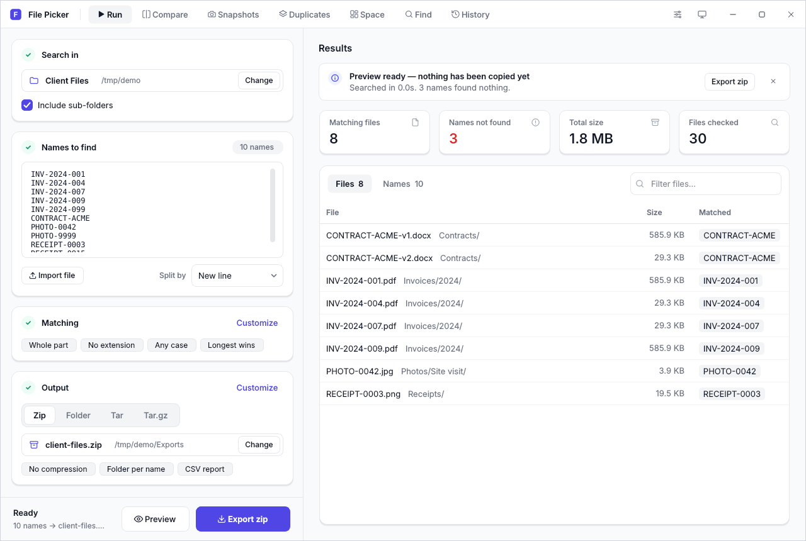

## Contents

- [What's inside](#whats-inside)
- [Download](#download)
- [Run from source](#run-from-source)
- [A tour of the tabs](#a-tour-of-the-tabs)
  - [Run: find files by name and export them](#run-find-files-by-name-and-export-them)
  - [Compare](#compare)
  - [Snapshots](#snapshots)
  - [Duplicates](#duplicates)
  - [Space](#space)
  - [Find](#find)
  - [History](#history)
- [Options shared by every tab](#options-shared-by-every-tab)
- [Settings, data and the interface](#settings-data-and-the-interface)
- [Command-line interface](#command-line-interface)
- [How it works](#how-it-works)
- [Development](#development)

## What's inside

| Tab | Shortcut | Use it to… |
|---|---|---|
| **Run** | `Ctrl+1` | Find every file whose name contains one of your names (pasted or imported from TXT/CSV) and export them to ZIP, TAR, TAR.GZ or a folder. |
| **Compare** | `Ctrl+2` | See how two folders differ: identical, different, moved, or only on one side. |
| **Snapshots** | `Ctrl+3` | Log a folder, scan it again later, and see exactly what was added, removed, modified or moved. |
| **Duplicates** | `Ctrl+4` | Find files with identical content, see the space they waste, and move the extras to the Trash. |
| **Space** | `Ctrl+5` | See what is using your disk as a map you can click through. |
| **Find** | `Ctrl+6` | Search a folder or drive by describing the file. Typos and synonyms are fine. |
| **History** | `Ctrl+7` | Review every export, reload its settings or run it again. |

Also included: previews of pictures and text, `.gitignore`-style ignore rules, skipping of online-only cloud files (OneDrive, iCloud), HTML and PDF reports, light and dark themes, and a command-line mode.

## Download

Prebuilt programs are attached to each release on the repository's [Releases page](https://github.com/Sepiolina/Files-Picker/releases). Every push to `main` also produces the same files as downloadable *artifacts* of the [Build workflow](https://github.com/Sepiolina/Files-Picker/actions/workflows/build.yml).

| Platform | File | How to start it |
|---|---|---|
| Windows 10 / 11 (x64) | `FilePicker-windows-x64.exe` | Double-click. See [Windows security warnings](#windows-security-warnings) if SmartScreen appears. |
| macOS (Apple silicon) | `FilePicker-macos-arm64.zip` | Unzip, then right-click `FilePicker.app` → **Open** the first time (the app is not code-signed). Or run `xattr -dr com.apple.quarantine FilePicker.app`. |
| Linux (x64) | `FilePicker-linux-x64.tar.gz` | `tar -xzf FilePicker-linux-x64.tar.gz && ./FilePicker`. On a minimal install you may need `sudo apt install libxcb-cursor0`. |
| Command-line engine only | `picker-engine-<os>-<arch>` | The Go engine without the interface (see [Command-line interface](#command-line-interface)). |

Each release also includes `SHA256SUMS.txt` so downloads can be verified. Intel Macs can run from source or get a build by adding an Intel macOS runner to the matrix in `.github/workflows/build.yml`.

## Run from source

You need [Go](https://go.dev/dl/) 1.22 or later and [Python](https://www.python.org/downloads/) 3.10 or later.

```bash
git clone https://github.com/Sepiolina/Files-Picker.git
cd Files-Picker

./build.sh                          # macOS / Linux: build the search engine   (Windows: build.cmd)
pip install -r gui/requirements.txt # the interface
python gui/run_gui.py               # start File Picker
```

`build.cmd` can be double-clicked in File Explorer; it runs `build.ps1` without changing your PowerShell execution policy. The build scripts report common problems such as a missing or too-old Go.

The engine is optional for the analysis tabs (Compare, Snapshots, Duplicates, Space, Find): without it they use a built-in Python scanner with identical results, just slower on very large folders. The Run tab always needs the engine.

## A tour of the tabs

### Run: find files by name and export them

Four steps, with a checkmark on each completed step:

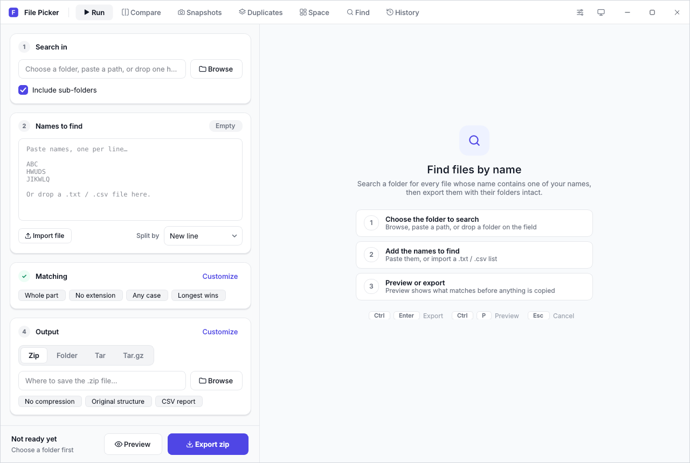

**1. Search in.** Browse for a folder or drop one on the field. Sub-folders are included by default.

**2. Names to find.** Paste names, import a `.txt` or `.csv` file, or drop a file on the box. For CSV files choose whether there is a header row and which column holds the names. The header shows how many names, unique names and duplicates you have; hover for details.

**3. Matching.** The defaults suit most searches; **Customize** opens the rest.

| Setting | Description |
|---|---|
| Match mode | Whole part (default), Anywhere, Exact name, Starts with, or Ends with |
| Compare with | Filename without extension, filename with extension, or relative file path |
| Case sensitivity | Case-insensitive by default |
| Duplicates | Merge duplicate entries (keeping the first or last spelling) or stop and report them |
| Multiple matches | When a file matches several names: longest, shortest, first in the list, or all |
| File types | Limit results to extensions such as `pdf, jpg`, or leave empty for all |

With the default **Whole part** mode, `abc` matches `gg_abc_.txt` and `dq122130219_abc_1291291.txt`, but not `gg_abcde_.txt`. That suits file names with identifiers separated by underscores or dashes. The *multiple matches* setting only matters for exports using **One folder per name**.

**4. Output.** ZIP, Folder (copy), TAR or TAR.GZ. Optional: **One folder per name** and a **CSV report**. The action bar always says what will happen, for example `10 names → client-files.zip`.

Then **Preview** (see what matches, copy nothing) or **Export** (`Ctrl+Enter`). The result cards show matching files, names not found, total size and files checked; the **Names** tab lists every name and what it matched, and **Only not found** narrows it to the misses.

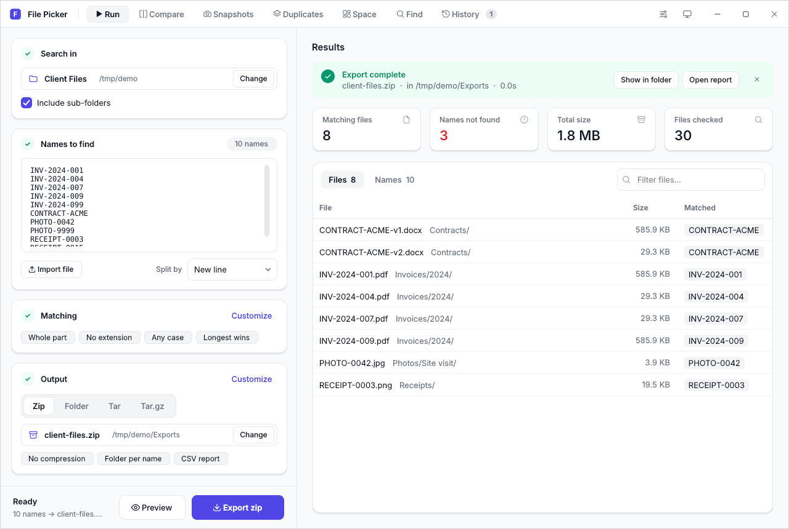

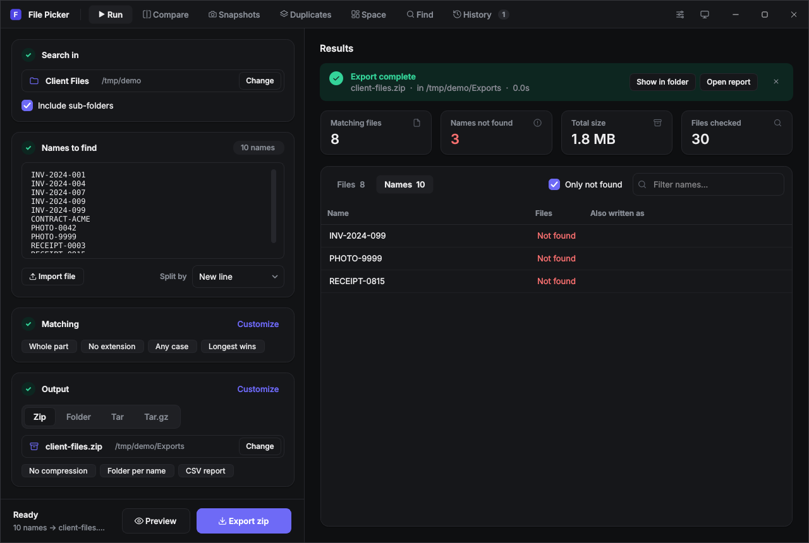

### Compare

Pick any two folders (same drive or different drives) and see how they differ.

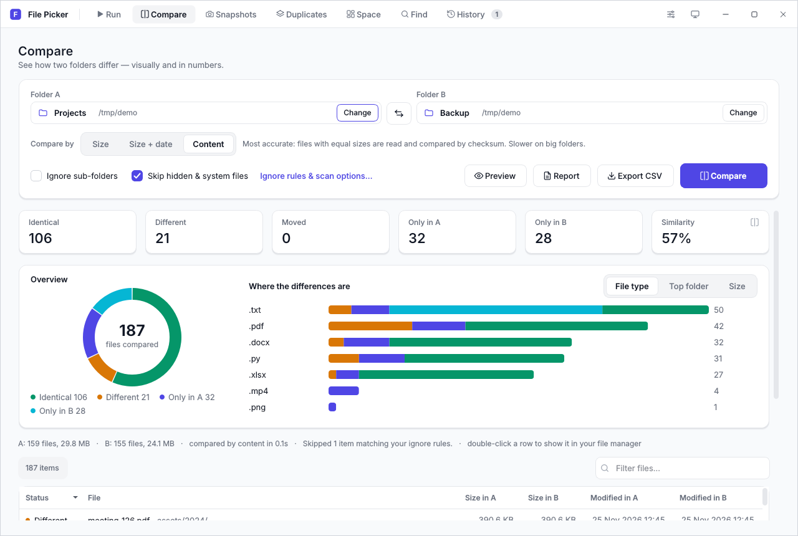

- **Compare by:** *Size* (fastest), *Size + date* (2-second tolerance for FAT drives) or *Content* (files with equal sizes are compared by checksum).
- **Ignore sub-folders** pairs files by name only, for folders that are organised differently.
- A file with the same name and size in a *different sub-folder* counts as **Moved**.
- Click a count tile to filter the table; the chart groups differences by file type, top folder or size.
- **Preview** shows the selected file from A and B side by side. **Export CSV** and **Report** save the result.

### Snapshots

Scan a folder and everything below it, keep the result as a log, scan again later, and see what changed.

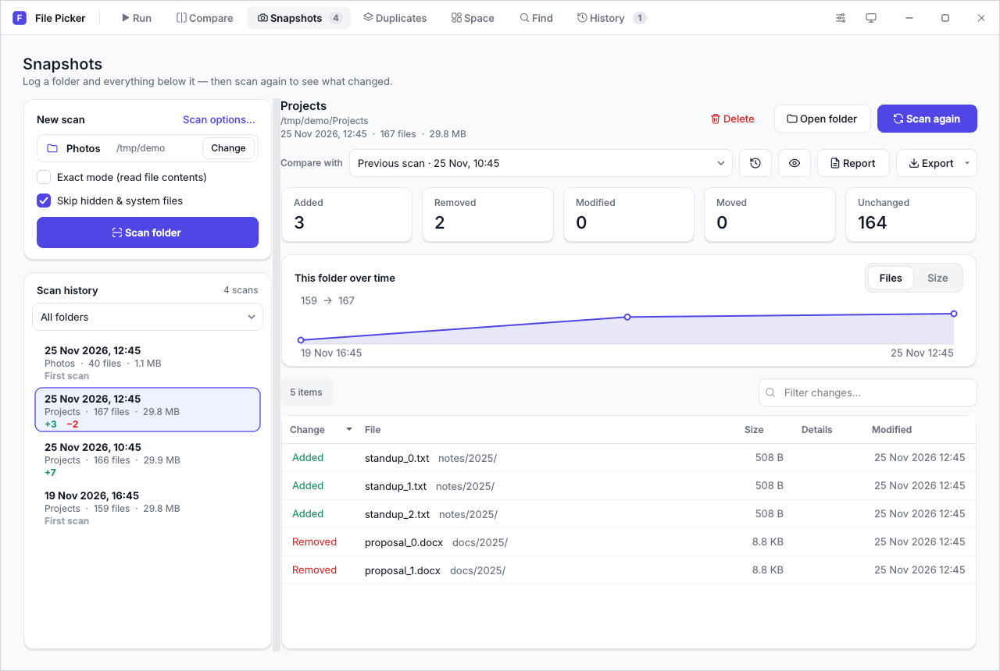

The screen has two panes:

- **Left: New scan and Scan history.** Choose a folder and press **Scan folder**. Each past scan is a card showing its date, folder, size and what changed since the scan before it (`+3 −2 ~1`). When you have scanned more than one folder, a filter lists them. Right-click a scan for *Scan again*, *Open folder* and *Delete*.
- **Right: the selected scan.** **Scan again** repeats the scan and compares it with the previous one. **Compare with** can use any older scan of the same folder. The tiles count added, removed, modified, moved and unchanged files; click one to filter the list below it. In the toolbar, the clock button toggles a **history chart** of the folder's file count or size over time, the eye button toggles a **preview** of the selected file, **Report** saves a shareable report, and **Export** saves CSV (the changes shown, or every file in the scan).

**Exact mode (read file contents)** computes a checksum for every file, so edits and renames are detected exactly. It is slower the first time; unchanged files are not read again on later scans. Without it, changes are detected by size and modified time. Scans are stored compressed, one file per scan.

### Duplicates

Finds files with identical content, even when the names differ.

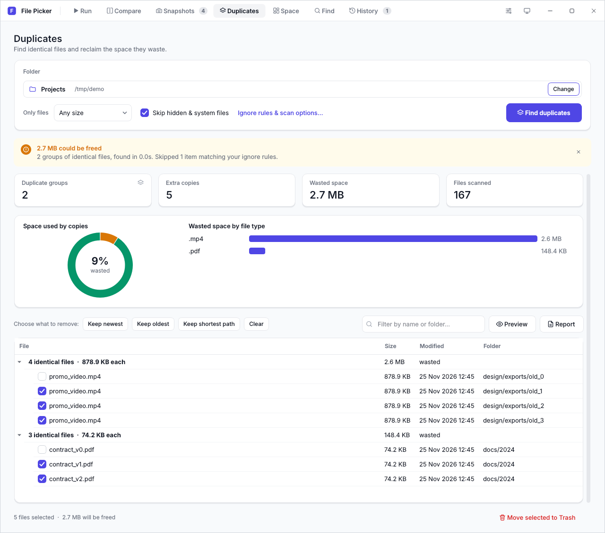

Files are compared cheaply first, so most are never read in full: same size, then same first 64 KB, then same checksum of the whole file. You then choose what to keep:

- **Keep newest**, **Keep oldest** or **Keep shortest path** tick all the other copies; you can also tick files by hand.
- **Move selected to Trash** sends them to the Trash / Recycle Bin after a confirmation, so they can be restored. Every group always keeps at least one copy.
- **Only files** sets a minimum size (for example *1 MB or more*), so small files that rarely matter for disk space are ignored.
- The tab lists the 3,000 groups wasting the most space.

### Space

A map of what uses your disk. Every folder and large file is a tile whose area is its size.

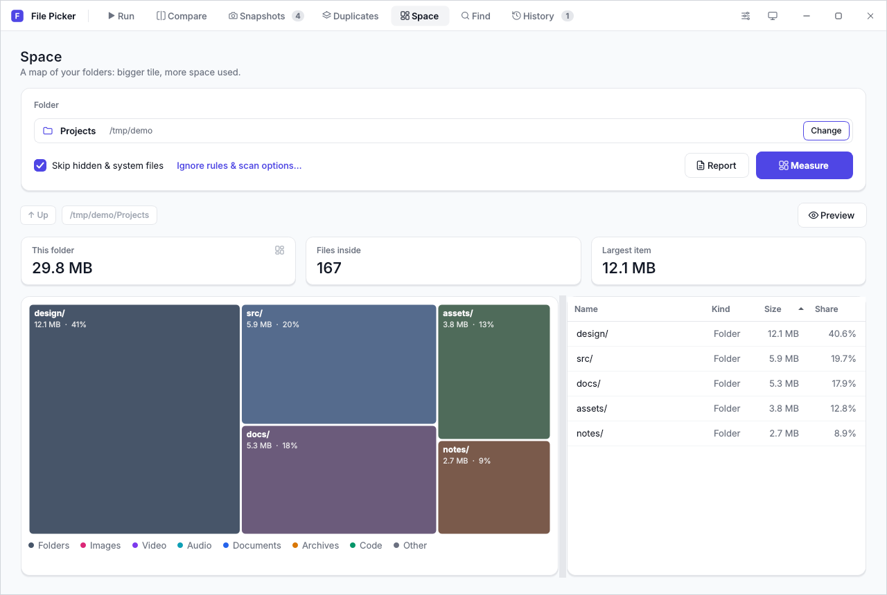

Click a folder tile to look inside it, and use the breadcrumb or **↑ Up** to go back. Folders are slate-coloured; files are coloured by type (images, video, audio, documents, archives, code). Each folder shows its 60 largest files and groups the rest, and the list on the right gives exact sizes. A whole drive works too.

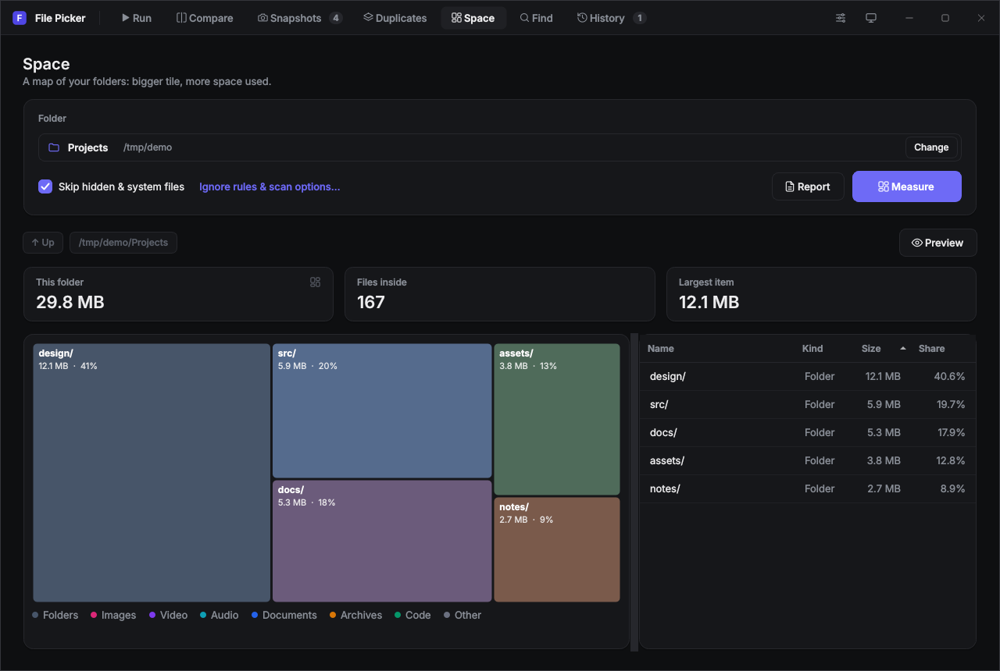

### Find

Search a folder or a whole drive by describing the file.

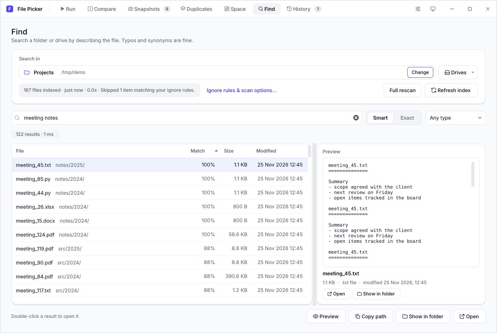

- **Smart** search understands word forms, synonyms (`bill` finds invoices), file-type concepts (`photos` finds `.jpg` and `.png` files) and typos (`recipt`). **Exact** does substring matching and supports `*` and `?` wildcards.
- The first search builds an index of file and folder names, which is saved to disk. Reopening the app is instant, and **Refresh index** re-reads only the folders whose contents changed (**Full rescan** re-reads everything).
- Every query and its result is remembered, so repeating a search is instant, even after a restart. The remembered results are discarded when the index changes.
- It searches *names*, not file contents, and uses no machine-learning model, so nothing leaves your computer.
- The **Drives** menu lists your drives. Double-click a result to open it, or use **Show in folder** and **Copy path**.

### History

Every export from the Run tab is recorded with its settings.

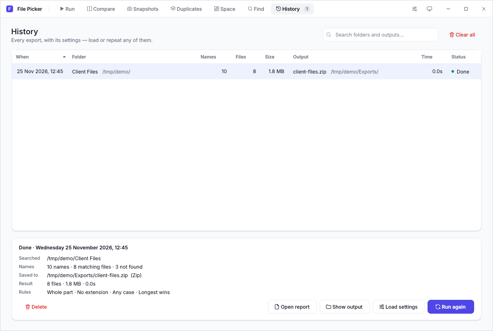

From a past run you can **Load settings**, **Run again**, **Show output** or **Open report**.

## Options shared by every tab

### Previews and reports

- **Preview** (the eye button on each tab): pictures are shown scaled, and text files show their first lines. Only the start of a file is read, very large pictures are skipped, and online-only cloud files are never opened.
- **Report** (Compare, Snapshots, Duplicates, Space): saves a self-contained `.html` file (the charts are inline SVG; nothing external) or a `.pdf`. Reports use a print-friendly light palette. HTML reports list up to 3,000 table rows, PDF reports up to 800.

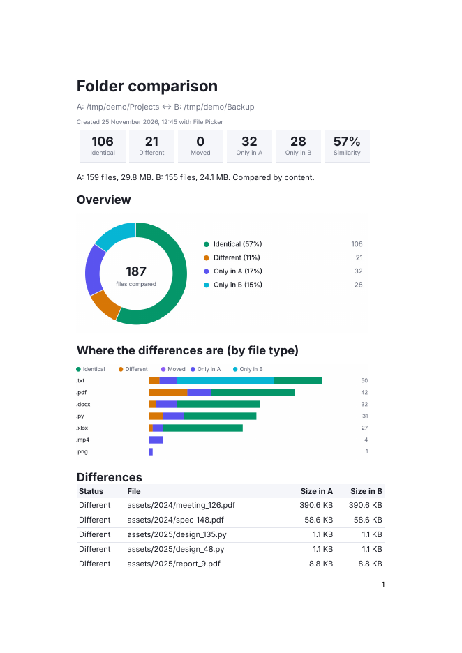

### Scan options

The sliders button in the title bar (or **Scan options…** on each tab) opens the options used by Compare, Snapshots, Duplicates, Space and Find.

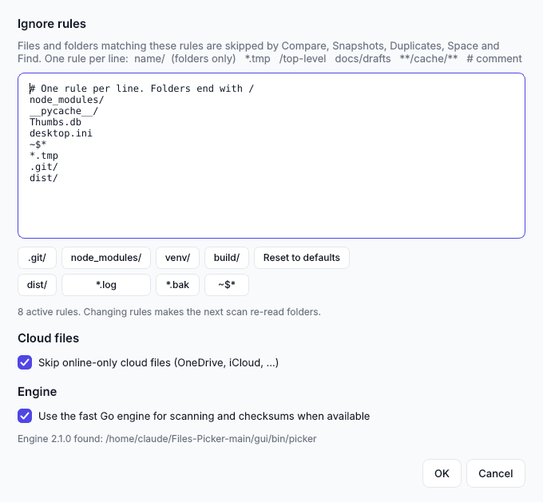

- **Ignore rules** are a subset of `.gitignore` syntax, one per line and case-insensitive: `node_modules/` (folders only), `*.tmp`, `/build` (top level only), `docs/drafts` (any rule containing `/` is relative to the scanned folder), `**/cache/**`, and `# comments`. `!negation` is not supported. The defaults skip `node_modules/`, `__pycache__/`, `Thumbs.db`, `desktop.ini`, `~$*` and `*.tmp`. The Run tab has its own matching and does not use these rules.
- **Skip online-only cloud files** (on by default) skips OneDrive "Files On-Demand" placeholders on Windows and iCloud / File Provider placeholders on macOS. They are never opened or hashed, so nothing is downloaded, and each tab says how many were skipped. Linux has no such placeholders.
- **Use the fast Go engine** shows whether the engine was found and is new enough (2.1 or later).

Changing these options makes the next scan, and the Find index, re-read folders, so cached results never disagree with your rules.

## Settings, data and the interface

File Picker saves your settings as you work and restores them at the next start: the folders, options and names of every tab, the ignore rules, the window size and the theme.

Application data lives in the standard user data directory:

| Operating system | Location |
|---|---|
| Windows | `%APPDATA%\FilePicker\FilePicker` |
| macOS | `~/Library/Application Support/FilePicker/FilePicker` |
| Linux | `~/.local/share/FilePicker/FilePicker` |

Besides settings and history, that folder holds `snapshots/` (the Snapshots log) and `search_cache/` (the Find index and remembered searches); delete them to start fresh. Name lists are stored once and referenced by settings and history, so a 180,000-name list is not duplicated for every export.

**Keyboard shortcuts**

| Shortcut | Action |
|---|---|
| `Ctrl+1` … `Ctrl+7` | Open Run, Compare, Snapshots, Duplicates, Space, Find, History |
| `Ctrl+Enter` | Start the export (Run tab) |
| `Ctrl+P` | Preview the matches (Run tab) |
| `Esc` | Cancel the current operation |

**Window.** File Picker uses a custom title bar with the tabs, theme menu and window controls, while keeping native behaviour. On Windows 10 and 11 that includes dragging to move, double-click to maximize, Aero Snap and Windows 11 Snap Layouts, native shadows and rounded corners, and a maximized window that respects the taskbar. On macOS and Linux the window manager handles moving and resizing. If the custom title bar causes problems on a Windows system, start the app with `FILEPICKER_NATIVE_FRAME=1` to use the standard frame.

## Command-line interface

The engine also runs without the interface, for scripts and scheduled tasks.

```bash
gui/bin/picker example > job.json                    # a sample job with every option and its default
gui/bin/picker scan   --job job.json --format text   # preview the matches; copies nothing
gui/bin/picker export --job job.json --format text   # search and export
```

The analysis tabs use two more commands, which are handy in scripts too:

```bash
echo '{"root":"/data","skipHidden":true,"ignore":"node_modules/\n*.tmp"}' | gui/bin/picker tree --format text
echo '{"root":"/data","files":["a/x.txt","b/y.bin"]}' | gui/bin/picker hash
```

`tree` lists every folder with its files' sizes and modified times, in parallel. `hash` prints SHA-256 checksums (the first 16 bytes, as hex). Both stream JSON events and can be cancelled. The job format and events are documented in [docs/PROTOCOL.md](docs/PROTOCOL.md).

## How it works

**A Go engine and a Python / Qt interface, as separate processes.**

- The **Go engine** does directory scanning, name matching, checksums and exports. Go gives fast, concurrent code that compiles to a standalone executable for every platform.
- The **Python and Qt interface** provides native dialogs, efficient tables and a consistent look on every system.
- Running the engine as its own process keeps the interface responsive during long scans and makes the engine usable from scripts. The two communicate through a documented protocol ([docs/PROTOCOL.md](docs/PROTOCOL.md)), so either can be updated independently.

**Performance.**

- The engine matches file names and paths without opening file contents, so speed depends on the number of files and the filesystem, not on how much data they hold. Searching a 31 GB directory does not read 31 GB; only exported files are read. In testing, **180,000 files against 180,000 names took about 1.5 seconds** (results vary with hardware and settings).
- For exports of already-compressed files (JPEG, video, many PDFs) choose **Fastest (no compression)**, since extra compression saves little and costs time.
- The analysis tabs use the engine's parallel scanner when it is available. Re-scans of a cached folder skip every folder whose modified time has not changed.

**Reliability.**

- Archives are written to a temporary `.partial` file and renamed only on success, so a cancelled or interrupted export never leaves an incomplete archive under the final name.
- ZIP64 is enabled automatically, so files and archives larger than 4 GB work.
- The only files of yours that File Picker ever removes are duplicates you choose to move to the Trash. It asks first, they can be restored, and one copy of each file is always kept. (Deleting a scan or the history only removes File Picker's own records.)

## Development

### Project structure

```text
Files-Picker/
├── engine/       Go engine: search, export, and the fast tree / hash scanners
├── gui/          Python and Qt interface (tests in gui/tests)
├── docs/         Protocol documentation and screenshots
├── .github/      GitHub Actions workflows (tests, packaging, releases)
├── build.sh / build.ps1 / build.cmd      Build the engine
└── package.sh / package.ps1 / package.cmd  Build the standalone application
```

### Tests

```bash
cd engine && go test ./...                 # Go engine
python -m unittest discover gui/tests      # Python (build the engine first so the parity tests run)
python gui/run_gui.py --check              # self-test: engine, analysis commands, report support
```

The engine tests cover filename list parsing, every matching mode, overlapping-match rules, full ZIP exports, cancellation, the ignore-rule matcher, the parallel folder walker, and the checksum code. The Python tests include **parity tests** that scan the same folders with the Go engine and with the built-in Python scanner and require identical results (file lists, checksums, ignore rules, cached-folder reuse, cancellation and the fallback when the engine is missing), plus checks that every module compiles on the oldest supported Python and that each tab's layout holds at the smallest window size. Qt tests run headless (`QT_QPA_PLATFORM=offscreen`).

### Building a standalone application

A standalone build runs on another computer without Python, Go or any dependencies.

**Windows:** double-click `package.cmd`, or run it from a terminal. It builds the engine, creates an isolated Python environment (`.venv-build`), installs PyInstaller, bundles the interface, Qt and engine, and verifies the result. The output is `dist\FilePicker.exe`. This needs Go 1.22+ and Python 3.10+ on your `PATH`; the first build downloads PySide6 and PyInstaller.

By default you get a single file, which unpacks itself at start-up (a few seconds). For faster start-up use a folder build, `package.cmd -OneFolder`, which creates `dist\FilePicker\`; zip the whole folder to distribute it.

**macOS and Linux:** run `./package.sh`. The output is `dist/FilePicker.app` on macOS and `dist/FilePicker` on Linux.

**Verify a build** with `FilePicker.exe --check` (or `./dist/FilePicker --check`). It checks that the bundled engine is found and runs, that it supports `tree` and `hash` and agrees with the built-in scanner, and that the Qt modules for reports are included. The exit code is `0` when everything passes, otherwise `1` engine missing, `2` engine too old, `3` results differ, `4` a Qt module is missing.

#### Windows security warnings

The executable is not digitally signed, so Windows SmartScreen may warn when you run it on another computer. If you trust the build and its source, choose **More info → Run anyway**. Some antivirus products flag unsigned PyInstaller executables; folder builds are less likely to. Code signing is recommended for wider distribution.

### Continuous integration and releases

Two GitHub Actions workflows live in `.github/workflows/`.

**`ci.yml` runs the tests.** It runs on pull requests, on pushes to branches other than `main`, and whenever `build.yml` calls it.

| Job | Runs on | What it does |
|---|---|---|
| Engine | Ubuntu, Windows, macOS | `gofmt` check (Linux), `go vet`, `go test`; on Linux it also cross-compiles the engine for all six targets |
| GUI | Ubuntu (Python 3.10 and 3.12), Windows, macOS | builds the engine, installs the GUI requirements, runs the Python tests, then `run_gui.py --check` |

**`build.yml` packages and releases.** It runs on every push to `main`, on version tags (`v*`), and manually from the **Actions** tab (*Build → Run workflow*).

1. It calls `ci.yml` first (these appear as the `test / …` jobs of a Build run); nothing is packaged if a test fails.
2. **Package** runs `package.ps1` / `package.sh` on Windows, macOS and Linux runners, producing `FilePicker-windows-x64.exe`, `FilePicker-macos-arm64.zip` and `FilePicker-linux-x64.tar.gz`. Those scripts run `--check` on the result and fail the job if the packaged app cannot run its engine.
3. **Command-line engine** cross-compiles `picker` for Windows, macOS and Linux (x64 and arm64).
4. **Release** (tags only) writes `SHA256SUMS.txt` and publishes a GitHub Release with generated notes.

Files from non-tag runs are kept for 30 days as workflow artifacts. To publish a release:

```bash
git tag v2.1.0
git push origin v2.1.0
```

No secrets are needed: the release step uses the repository's built-in token with `contents: write` permission, granted to that one job only. The macOS and Windows programs are not code-signed; add signing and notarization steps to `build.yml` if you need to remove the security prompts.
