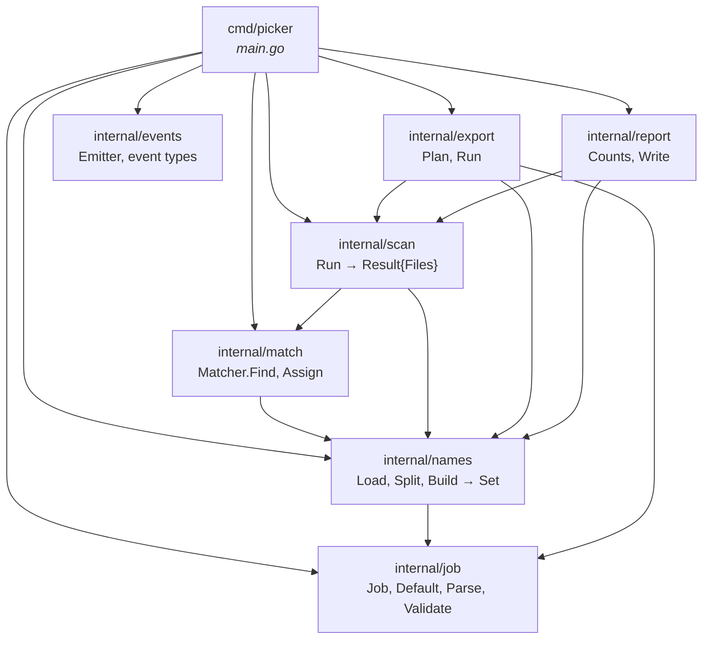
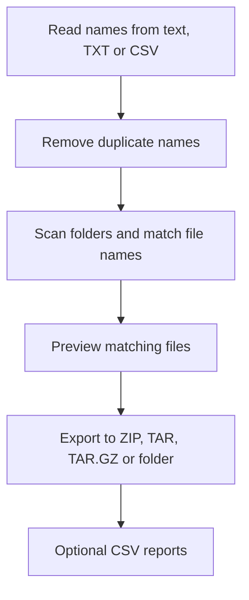
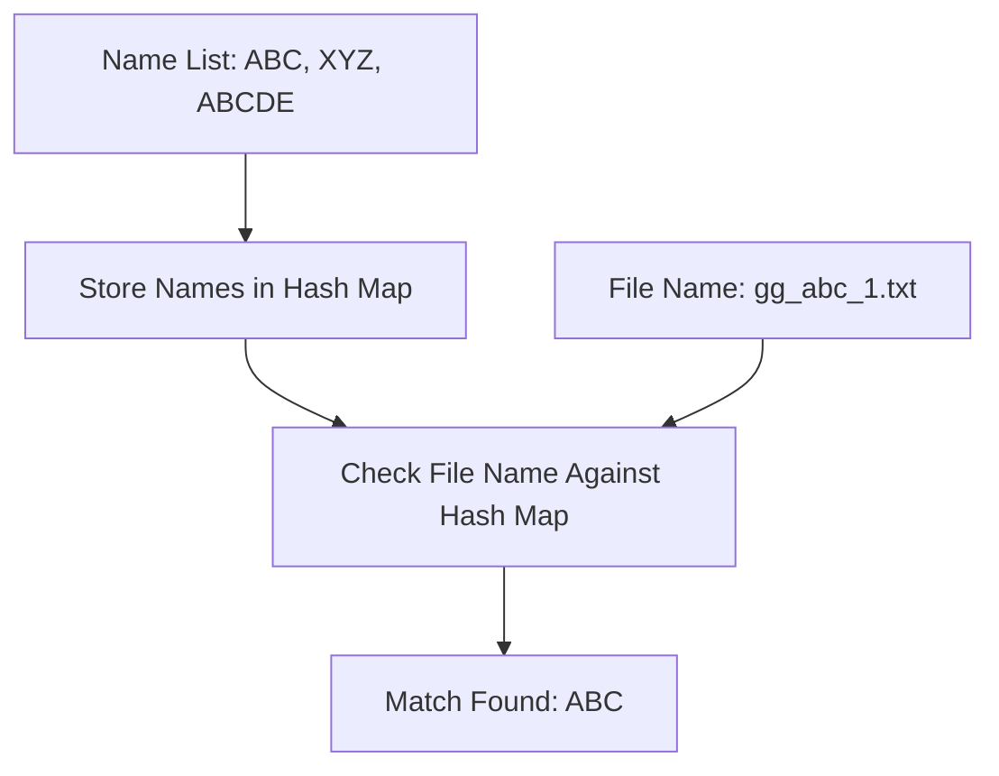
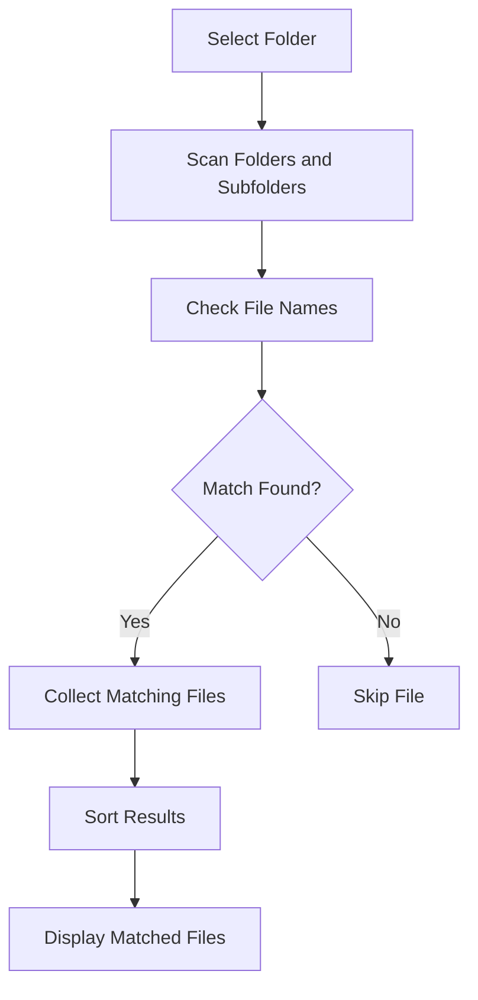
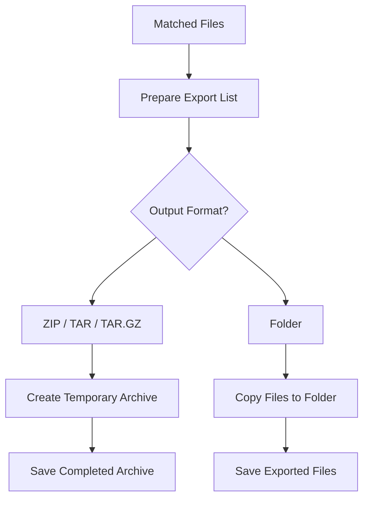
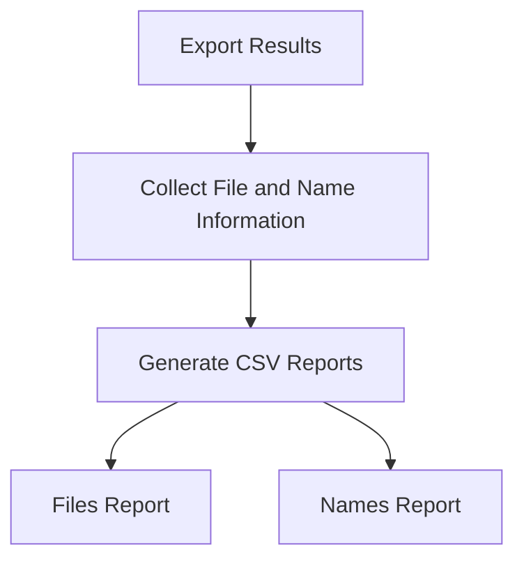
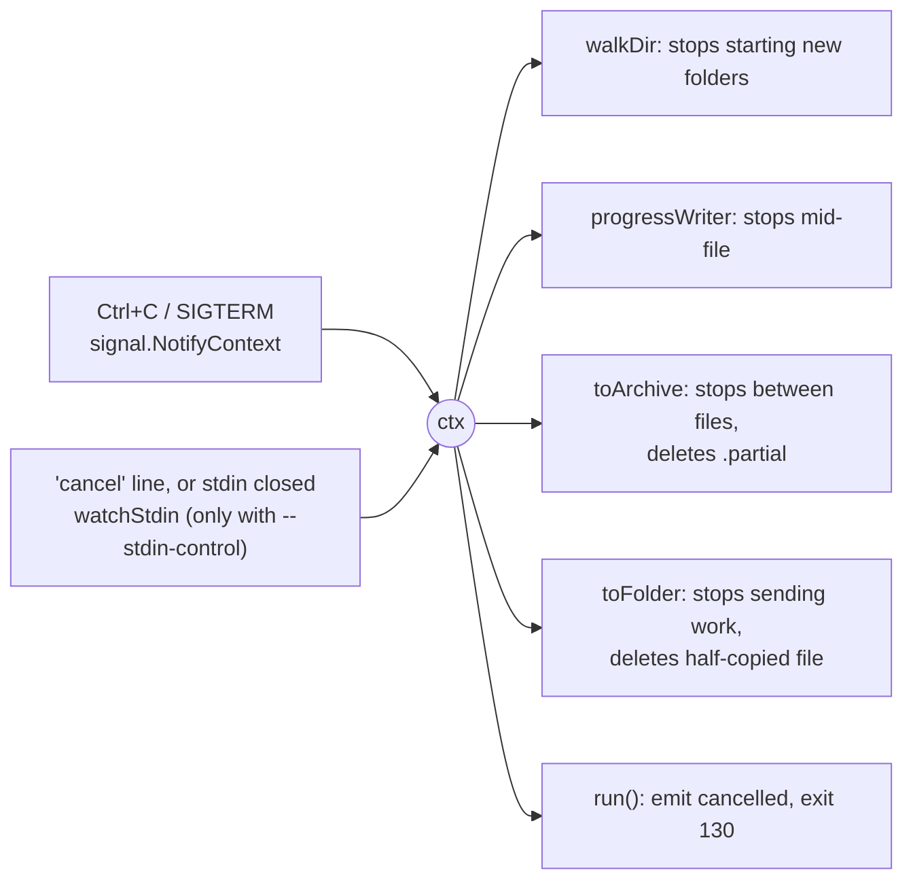

The engine (`engine/`) is the Go program `picker`. It does all the real work: it reads the name list, walks the folder tree, decides which files match and writes the zip, tar or folder. 
It has no GUI code.

 The GUI ([`gui/picker_gui/engine.py`](../gui/picker_gui/engine.py)) starts it as a child process and reads what it prints.


 ## Packages

```
engine/
├── go.mod                     module filepicker/engine (Go 1.22, standard library only)
├── cmd/picker/main.go         entry point: flags, reading the job, cancellation, the pipeline
└── internal/
    ├── job/      job.go       the Job struct, defaults, JSON parsing, validation
    ├── names/    names.go     raw list (text / .txt / .csv) → de-duplicated name set
    ├── match/    match.go     "which names appear in this file name?" + the overlap rule
    ├── scan/     scan.go      parallel folder walk, collects matching files
    ├── export/   export.go    plan + write zip / tar / tar.gz / folder
    ├── report/   report.go    the two CSV reports and per-name counts
    └── events/   events.go    the output protocol: JSON lines or readable text
```

Dependencies only point one way, so each package can be read and tested on its own:



`events` depends on nothing else in the engine, and only `main` writes to stdout.


 ## How it works



### Main steps

1. **Read names:** Load and clean a list of names or keywords.
2. **Find matches:** Search file names using rules such as exact, prefix, suffix, contains or whole-part matching.
3. **Scan folders:** Check folders in parallel, without reading file contents.
4. **Export files:** Save matching files to an archive or folder.
5. **Create reports (optional):** Record matched files and names that were found or missing.

## Step 1: Read names (`internal/names`)

`Load` gets the raw text from `list.text`, or reads `list.file` (UTF-8 with or without BOM, or UTF-16, which is what Excel and Notepad save). `Split` turns it into entries:

1. Normalise line endings (`\r\n`, `\r` → `\n`).
2. Split into rows and cells by the separator. A single-character separator with `csvQuotes` uses Go's real CSV reader, so `"x, y"` stays one cell.
3. If `header` is set, drop the first row, and resolve `column` by header name or by 1-based number.
4. Trim and drop empty cells.

`Build` then de-duplicates. Each `Name` has:

| Field       | Meaning |
|-------------|---------|
| `Key`       | what is compared with file names; lower-cased unless matching is case-sensitive |
| `Text`      | the spelling shown to the user (first or last one seen, per `duplicates`) |
| `Spellings` | every spelling seen; more than one means it was duplicated |

From here on, a name is referred to by its **index** in `Set.Names`. Scan results, reports and preview all store `[]int` indexes, not strings.

## Step 2: Matching (`internal/match`)

The matching system checks whether a file name contains any name from the user's list.

Instead of comparing every name with every file, it uses a **hash map** to search faster.

### How Matching Works

1. **Prepare names:** Store all names in a hash map for quick lookup.
2. **Check file name:** Compare parts of the file name with the stored names.
3. **Find matches:** Return the names that match.

### Matching Flow



For example, if the list contains `ABC`, `XYZ`, and `ABCDE`, and the file name is `gg_abc_1.txt`, the engine finds `ABC` (with case-insensitive matching).

### Matching Modes

| Mode | Description | Example |
|---|---|---|
| `exact` | File name must match exactly | `abc` = `abc` |
| `prefix` | File name starts with the name | `abc_123` |
| `suffix` | File name ends with the name | `123_abc` |
| `contains` | Name appears anywhere | `123abc456` |
| `whole` | Name appears as a separate part | `123_abc_456` |

By default, matching uses the **file name without its extension**. It can also check the full file name or relative file path.

### Handling Multiple Matches

Sometimes a file matches more than one name. The engine uses an **overlap rule** to decide which name gets the file when organizing files into separate folders.

| Rule | Description |
|---|---|
| `longest` | Choose the longest matching name |
| `shortest` | Choose the shortest matching name |
| `first` | Choose the first matching name in the list |
| `all` | Assign the file to every matching name |

The engine keeps both:
- **Matched:** All names found in the file name, used for reports.
- **Assigned:** The selected name(s), used to decide the destination folder when grouping by name.

### Summary

The matching system uses a **hash map to quickly identify matching files** without comparing every file against every name individually. It supports different matching modes and can handle files that match multiple names.

## Step 3: Scanning (`internal/scan`)

The scanning system searches through folders to find files that match the user's name list.

It uses **parallel scanning** to check multiple folders at the same time, making the process faster.

### How Scanning Works

1. **Select folder:** Start from the folder chosen by the user.
2. **Scan files:** Search through the folder and its subfolders.
3. **Check matches:** Compare file names with the name list using the matching system.
4. **Collect results:** Save matching files and their information.
5. **Sort results:** Organize matched files in a consistent order.

### Scanning Flow



### Important Features

| Feature | Description |
|---|---|
| Parallel scanning | Scans multiple folders at once for better speed |
| File name checking | Checks file names without reading file contents |
| File filtering | Skips files that do not meet the matching rules |
| Error handling | Unreadable folders produce warnings without stopping the entire scan |
| Sorting | Organizes results in a consistent order |
| Output exclusion | Prevents the engine from scanning its own output files |

### Summary

The scanning system **quickly searches folders and subfolders**, checks file names, and collects matching files. It uses parallel processing to improve speed and handles unreadable folders safely.

---

## Step 4: Export (`internal/export`)

The export system takes the matched files from the scanning process and saves them in the user's selected output format.

It supports **ZIP, TAR, TAR.GZ, and regular folders**.

### How Export Works

1. **Prepare files:** Create a list of matched files and their destinations.
2. **Choose format:** Use the output format selected by the user.
3. **Organize files:** Optionally group files into folders based on matching names.
4. **Export files:** Create an archive or copy files into a folder.
5. **Finish safely:** Complete the export and clean up incomplete files if needed.

### Export Flow



### Supported Export Formats

| Format | Description |
|---|---|
| `ZIP` | Creates a ZIP archive |
| `TAR` | Creates a TAR archive |
| `TAR.GZ` | Creates a compressed TAR archive |
| `Folder` | Copies matched files into a destination folder |

### Important Features

- **Safe exporting:** Archives are first written as temporary files and renamed when complete.
- **Parallel copying:** Folder exports use 4 workers to copy files faster.
- **File conflicts:** Existing files can be renamed, overwritten, or skipped.
- **Cancellation:** Users can stop exporting, and incomplete files are cleaned up.
- **Progress tracking:** The engine reports export progress to the GUI.

### Summary

The export system **organizes and saves matched files** in the selected format. It supports archives and folders, handles existing files, and helps prevent incomplete outputs.

---

## Step 5: Reports (`internal/report`)

The reporting system generates CSV files showing the results of the file search and export.

Reports are created when the **report option is enabled**.

### How Reporting Works

1. **Collect results:** Get information about matched files and names.
2. **Count matches:** Calculate how many files matched each name.
3. **Generate reports:** Create two CSV files.
4. **Save reports:** Store them alongside the exported files or inside the output folder.

### Reporting Flow



### Report Types

| Report | Description |
|---|---|
| `_files.csv` | Lists exported files, their sizes, and matched and assigned names |
| `_names.csv` | Lists names, match counts, missing names, and duplicate spellings |

### Important Features

- **Match tracking:** Shows which names were found or missing.
- **File information:** Records exported files and their sizes.
- **Excel compatibility:** CSV reports can be opened in Excel.
- **Error handling:** A report-writing failure produces a warning without failing the completed export.

### Summary

The reporting system **creates CSV reports** so users can easily check which files were exported, how many matches were found, and which names were missing.

## Cancellation

There is one `context.Context` per run, and everything long-running checks it:


